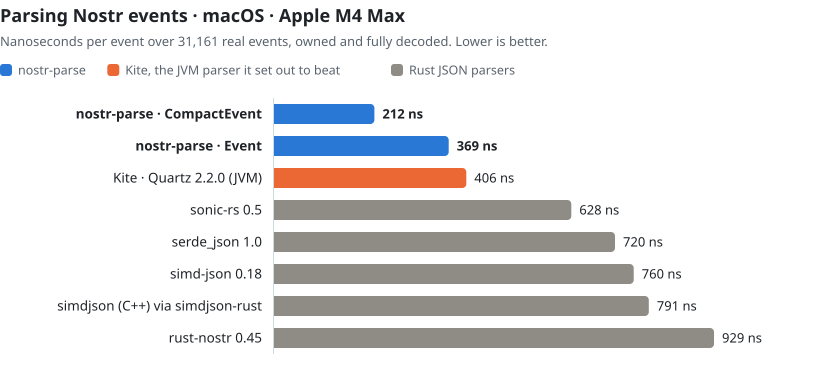
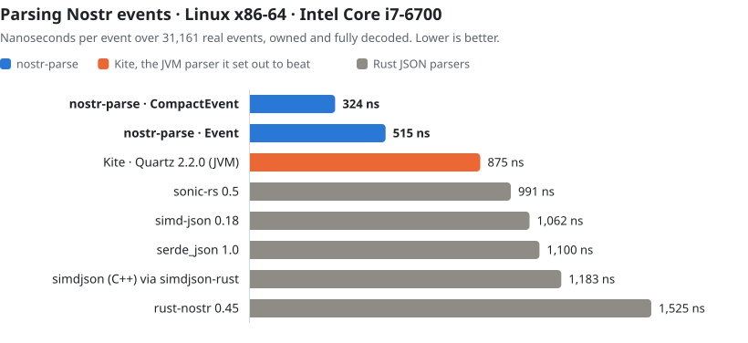

<h1 align="center">nostr-parse</h1>

<p align="center">
  <b>Nostr events, parsed fast.</b><br>
  A strict NIP-01 event parser in Rust. No dependencies, SIMD where it counts, one allocation per event.
</p>

<p align="center">
  <a href="LICENSE"></a>
  
  
</p>

<picture>
  <source media="(prefers-color-scheme: dark)" srcset="bench/macos-dark.svg">
  
</picture>

- **1.9–2.7× faster than Kite**, the hand-written JVM parser in
  [Amethyst](https://github.com/vitorpamplona/amethyst)'s Quartz library, on every workload on
  both machines measured.
- **3.0–3.7× faster than serde_json, sonic-rs, simd-json and simdjson** when each builds owned,
  decoded events, and 4.4–4.7× faster than rust-nostr's `Event::from_json`.
- **One allocation per event** with `CompactEvent`, however many tags it carries. The others
  make 14 to 21.

## Install

```toml
[dependencies]
nostr-parse = "0.3"
```

## Use

```rust
let mut parser = nostr_parse::Parser::new(); // keep it: its scratch space carries over

let event = parser.parse_compact(json)?;
println!("kind {} by {:02x?}…", event.kind, &event.pubkey[..4]);
println!("{}", event.content());
for tag in event.tags().iter() {
    println!("{:?} = {:?}", tag.name(), tag.get(1));
}
```

`nostr_parse::parse` and `nostr_parse::parse_compact` do the same with a fresh parser each call.

### Two shapes of the same event

| | tags and content | allocations | for |
|---|---|---|---|
| `CompactEvent` | one heap block, read through `content()` and `tags()` | 1 | reading: clients, relays, indexers |
| `Event` | `Vec<Vec<String>>` and a `String` | one per string | changing an event, or handing it to another library |

Both keep id and pubkey as `[u8; 32]`, sig as `Option<[u8; 64]>` (`None` for `""`, an unsigned
event such as a NIP-59 rumor), and `created_at` and `kind` as integers.

### Into rust-nostr

`Event` has the same shape as rust-nostr's, so converting moves the strings instead of copying
them:

```rust
use nostr::prelude::*;

fn to_nostr(e: nostr_parse::Event) -> Option<Event> {
    let tags: Vec<Tag> = e.tags.into_iter().map(Tag::parse).collect::<Result<_, _>>().ok()?;
    Some(Event::new(
        EventId::from_byte_array(e.id),
        PublicKey::from_byte_array(e.pubkey),
        Timestamp::from(e.created_at),
        Kind::from(e.kind),
        tags,
        e.content,
        Signature::from_byte_array(e.sig?),
    ))
}
```

Parsing and converting this way is still 2.4–2.8× faster than `Event::from_json` (the
"nostr-parse → rust-nostr" row below).

### Reading in place

A relay stores events rather than decoding them. `Parser::parse_spans` reads an event
where it sits:
- id, pubkey and sig are decoded to bytes;
- every string is a `RawStr`, the bytes between its quotes with escapes untouched, plus
  whether it has any;
- nothing is allocated or unescaped.

```rust
let ev = parser.parse_spans(text)?; // the event may be followed by more, as in ["EVENT", {...}]
let rest = &text[ev.end..];
for tag in ev.tags() {
    if tag.get(0).is_some_and(|name| name.bytes == b"expiration") { /* ... */ }
}
```

Strings are checked against JSON's grammar but not decoded, so a lone surrogate escape
(valid JSON, and what a client that cut an emoji in half sends) is accepted here.
`unusual` flags spellings that readers can disagree on: escaped keys or hex, and deeply
nested extra fields. A reader that has to match another one exactly can defer to it.

### Unsigned events (NIP-59 rumors)

A rumor has no signature; rust-nostr writes one with no `sig` key at all.
`Parser::parse_unsigned` reads it into an `UnsignedEvent` by rust-nostr's own rules:
- a `sig`, whatever it holds, is skipped like any unknown key;
- `id` may be absent or `null` (then `None`);
- the other fields, and refusing a duplicate key, are as for a signed event.

The signed readers are unchanged and still refuse an event with no `sig`. Converting into
rust-nostr's type:

```rust
use nostr::prelude::*;

fn to_nostr_unsigned(e: nostr_parse::UnsignedEvent) -> Option<UnsignedEvent> {
    let tags: Vec<Tag> = e.tags.into_iter().map(Tag::parse).collect::<Result<_, _>>().ok()?;
    let mut ev = UnsignedEvent::new(
        PublicKey::from_byte_array(e.pubkey),
        Timestamp::from(e.created_at),
        Kind::from(e.kind),
        tags,
        e.content,
    );
    ev.id = e.id.map(EventId::from_byte_array);
    Some(ev)
}
```

It is tested against rust-nostr's `UnsignedEvent::from_json`. Whenever `parse_unsigned`
accepts an event, rust-nostr reads exactly the same one, and whatever rust-nostr refuses,
`parse_unsigned` refuses too. A few spellings rust-nostr reads are refused here (uppercase
hex, bech32 keys); hand those to rust-nostr. A refusal is cheap, since it stops at the
first wrong field.

### Event ids

An event's id is the SHA-256 of its NIP-01 serialization,
`[0,"<pubkey>",<created_at>,<kind>,<tags>,"<content>"]`. `write_preimage` writes those
bytes into your hasher in pieces, instead of building them in a buffer. Every shape has
it, and a free function takes the fields from anywhere (rust-nostr's types, say):

```rust
use sha2::{Digest, Sha256};

let mut hasher = Sha256::new();
event.write_preimage(|bytes| hasher.update(bytes));
let id_matches = hasher.finalize().as_slice() == event.id;
```

The bytes are exactly the ones rust-nostr hashes (`serde_json::to_vec` of that tuple):
`"` and `\` escaped, control characters as `\b \t \n \f \r` or `\u00xx`, and everything
else, `/` and non-ASCII included, as plain UTF-8. Content with nothing to escape, as
almost all is, goes to the hasher as one slice. `EventSpans::write_preimage` works from
the strings as written: one with no escape is passed as the slice of the input it is,
copied nowhere. Escapes such as `\/`, `é` or a surrogate pair become the canonical
spelling, and only a lone surrogate, which no event can carry, gets `false`.

Against `serde_json::to_vec` of the same fields, then SHA-256 of the buffer, with the same
SHA-256 (sha2 0.11) for both, on an Apple M4 Max (`cargo run --release --example ids`):

| ns per id | serde_json | `write_preimage` | |
|---|---:|---:|---:|
| gift wrap, 1.6 KB base64 | 1,346 | 786 | 1.71× |
| seal, 700 B base64 | 641 | 376 | 1.70× |
| note, 200 B, 5 tags | 707 | 471 | 1.50× |
| article, 10 KB with escapes | 10,506 | 7,695 | 1.37× |

What remains is mostly the SHA-256 itself. The tests compare the bytes with serde_json's
on hand-picked escapes and on every event the fuzzer generates, and check that rust-nostr's
own `Event::verify_id` accepts ids computed from them.

## Benchmarks

Measured with [nostrJsonBench](https://github.com/vitorpamplona/nostrJsonBench), Vitor Pamplona's
cross-language harness. Its corpus is 31,161 real events, timed together (`all`) and split into
seven workloads by kind. Its rules are strict:
- every parser produces owned, fully decoded events;
- every output is checked against a reference digest, and a parser whose output differs isn't
  ranked.

Each machine ran three rounds, alternating the JVM and Rust harnesses. The figures are medians.

### macOS · Apple M4 Max

<!-- bench:macos:speed -->
| ns per event | all | notes | reactions | dms | giftwraps | metadata | zaps | lists |
|---|---:|---:|---:|---:|---:|---:|---:|---:|
| **nostr-parse `CompactEvent`** | **212** | **238** | **125** | **89** | **144** | **322** | **625** | **1,008** |
| **nostr-parse `Event`** | **369** | **504** | **282** | **172** | **227** | **358** | **895** | **2,025** |
| nostr-parse → rust-nostr `Event` | 388 | 526 | 305 | 189 | 245 | 377 | 912 | 2,048 |
| Kite, Quartz 2.2.0 (JVM) | 406 | 457 | 262 | 210 | 333 | 685 | 956 | 1,640 |
| sonic-rs 0.5.10 | 628 | 851 | 486 | 317 | 458 | 785 | 1,488 | 2,824 |
| serde_json 1.0.154 | 720 | 921 | 531 | 383 | 518 | 936 | 1,707 | 3,165 |
| simd-json 0.18.1 | 760 | 939 | 574 | 451 | 672 | 763 | 1,600 | 3,976 |
| simdjson-rust 0.4.0-alpha.2 (C++ simdjson) | 791 | 1,010 | 606 | 481 | 661 | 707 | 1,485 | 3,925 |
| rust-nostr 0.45.5 `Event::from_json` | 929 | 1,123 | 704 | 514 | 667 | 1,066 | 1,875 | 3,700 |
<!-- /bench -->

`CompactEvent` is the fastest on every workload. The plain `Event` pays one allocation per
string, where the JVM allocates almost for free, so Kite still beats it on notes, reactions and
lists here, and on lists on x86-64.

### Linux x86-64 · Intel Core i7-6700

<picture>
  <source media="(prefers-color-scheme: dark)" srcset="bench/x86-dark.svg">
  
</picture>

<!-- bench:x86:speed -->
| ns per event | all | notes | reactions | dms | giftwraps | metadata | zaps | lists |
|---|---:|---:|---:|---:|---:|---:|---:|---:|
| **nostr-parse `CompactEvent`** | **324** | **381** | **207** | **170** | **295** | **514** | **832** | **1,497** |
| **nostr-parse `Event`** | **515** | **711** | **365** | **247** | **359** | **544** | **1,034** | **3,878** |
| nostr-parse → rust-nostr `Event` | 554 | 753 | 398 | 282 | 392 | 569 | 1,072 | 3,963 |
| Kite, Quartz 2.2.0 (JVM) | 875 | 1,068 | 583 | 421 | 564 | 1,697 | 2,135 | 3,206 |
| sonic-rs 0.5.10 | 991 | 1,336 | 719 | 488 | 680 | 1,167 | 2,093 | 6,047 |
| simd-json 0.18.1 | 1,062 | 1,454 | 833 | 637 | 883 | 886 | 1,771 | 7,370 |
| serde_json 1.0.154 | 1,100 | 1,394 | 748 | 549 | 768 | 1,565 | 2,463 | 6,729 |
| simdjson-rust 0.4.0-alpha.2 (C++ simdjson) | 1,183 | 1,556 | 889 | 718 | 948 | 1,061 | 1,807 | 7,496 |
| rust-nostr 0.45.5 `Event::from_json` | 1,525 | 1,856 | 1,066 | 793 | 1,045 | 1,909 | 2,827 | 7,956 |
<!-- /bench -->

### Memory

The same runs on macOS, per event over all events:

<!-- bench:macos:memory -->
| per event, all events | allocations | bytes allocated | objects kept | bytes kept |
|---|---:|---:|---:|---:|
| **nostr-parse `CompactEvent`** | 1.0 | 534 | 1.0 | 702 |
| **nostr-parse `Event`** | 11.1 | 724 | 11.1 | 916 |
| nostr-parse → rust-nostr `Event` | 11.1 | 724 | 11.1 | 916 |
| Kite, Quartz 2.2.0 (JVM) | 21.3 | 1,321 | 21.4 | 1,289 |
| sonic-rs 0.5.10 | 15.8 | 1,675 | 14.0 | 1,281 |
| serde_json 1.0.154 | 15.4 | 1,644 | 14.0 | 1,281 |
| simd-json 0.18.1 | 15.3 | 2,705 | 14.0 | 1,109 |
| simdjson-rust 0.4.0-alpha.2 (C++ simdjson) | 14.0 | 973 | 14.0 | 1,109 |
| rust-nostr 0.45.5 `Event::from_json` | 16.3 | 1,687 | 11.1 | 1,087 |
<!-- /bench -->

The Rust rows count heap allocations, and Kite's row counts JVM objects. Bytes compare across
the two; object counts only within a runtime.

### NIP-59 rumors

2,000 kind-14 DM rumors as rust-nostr writes them, 549 B on average, a quarter of them
replies (`cargo run --release --example rumors`). ns per rumor (each run takes the median of
31 rounds):

| | macOS · M4 Max | Linux x86-64 · i7-6700 |
|---|---:|---:|
| rust-nostr `UnsignedEvent::from_json` | 641 | 889 |
| **`parse_unsigned`** | **221** | **264** |
| **`parse_unsigned`, into rust-nostr's `UnsignedEvent`** | **230** | **280** |
| refused, handed back (an uppercase id) | 53 | 104 |

With the conversion, that is 2.8× faster than rust-nostr on macOS and 3.2× on x86-64.

### Setup

- **Rust:** release builds (fat LTO, one codegen unit). rustc 1.95 with default flags on macOS;
  rustc 1.98 with `-C target-cpu=native` on x86-64.
- **JVM:** Kite ran with Quartz 2.2.0 on OpenJDK 21.0.13, G1 and `-Xmx2g`: Homebrew's build on
  macOS, Temurin on x86-64.
- **x86-64:** both harnesses were pinned to one core.
- **Harness:** nostr-parse's rows aren't in upstream nostrJsonBench yet; they are three small
  entries in its Rust harness.
- **Rumors:** built with rustc 1.85 on macOS and rustc 1.98 on x86-64, both with default
  flags; each figure is the median of three runs.
- **Raw data:** `bench/results.json` holds the medians, `bench/summarize.py` builds it from
  nostrJsonBench's output, and `bench/chart.py` and `bench/tables.py` draw the charts and tables
  above.

## Strict

The input must be one JSON object holding the seven NIP-01 fields once each. Other keys are
checked and skipped. The fields themselves:
- **id and pubkey:** 64 lowercase hex digits (JSON escapes allowed, as serde_json allows them).
- **sig:** 128 lowercase hex digits, or `""`.
- **created_at and kind:** plain non-negative integers; kind fits a `u16`.
- **tags:** arrays of strings.

Strings are fully unescaped, and a lone surrogate is refused. An error gives a message and the
byte offset where parsing stopped.

## How it's fast

- **One pass, no tree.** Fields are written straight into the event. Common key order takes a
  fast path; any order still parses.
- **16 bytes at a time.** String ends are found with NEON on aarch64 and SSE2 on x86-64, and
  scalar code everywhere else, wasm32 included.
- **Hex straight to bytes.** id, pubkey and sig are decoded 32 digits at a time into fixed
  arrays, with no strings in between.
- **Exact-size allocations.** Every string and list is allocated once, at its final size. A
  `CompactEvent` is a single allocation.

## Tested

- **Differential tests against serde_json:** every edge case, an escape at every offset of a
  16-byte block, and refusals with the same error from both shapes.
- **A generation-based fuzzer:** random events in every spelling, edits of them, and arbitrary
  JSON, against a serde_json reader of the same rules. About 52 million inputs, on arm64 and
  x86-64, without a disagreement.
- **The in-place and unsigned readers** are checked on every input too: the in-place reader
  against the serde_json reader, the unsigned reader against rust-nostr's own
  `UnsignedEvent::from_json`. A third of the generated events are rumor-shaped: no sig or a
  sig of any type, an id missing or `null`.

```bash
cargo test --release
FUZZ_SECS=600 cargo test --release --test fuzz -- --ignored --nocapture
```

## Minimum Rust

1.85.

## License

MIT, see [LICENSE](LICENSE).

Thanks to Vitor Pamplona, whose Kite and nostrJsonBench set the bar this was built to clear.
